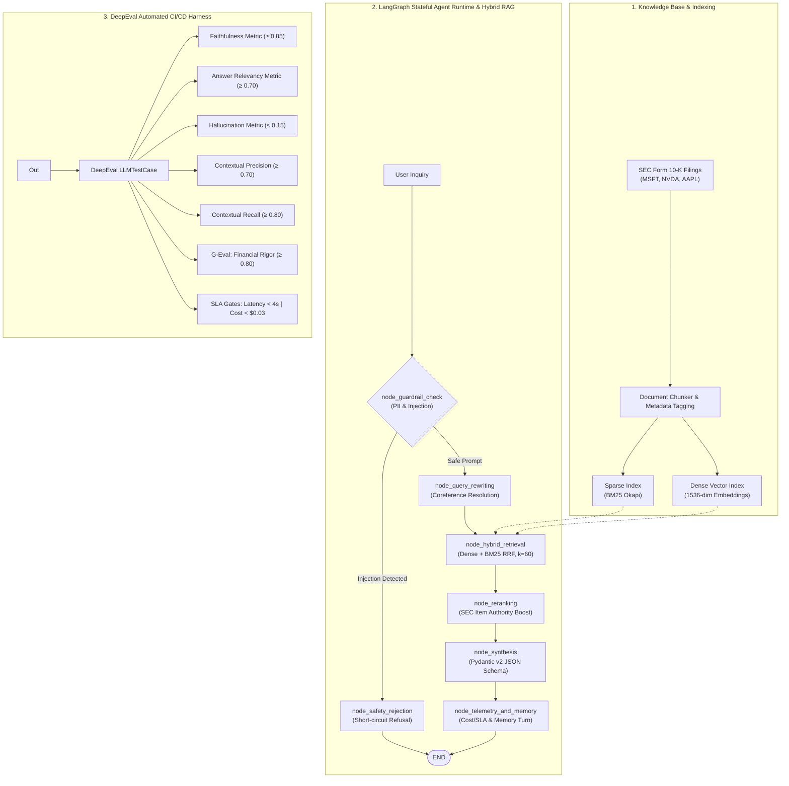

# FinSight: Enterprise Financial Due Diligence RAG & DeepEval Quality Framework

[](https://www.python.org/)
[](https://github.com/langchain-ai/langgraph)
[](https://github.com/confident-ai/deepeval)
[](https://docs.pydantic.dev/)
[](#evaluation-results)
[](LICENSE)

FinSight is a **production-grade, enterprise Retrieval-Augmented Generation (RAG) and Agentic AI system** designed for auditing SEC Form 10-K filings. Built with an **Evaluation-Driven Development (EDD)** methodology, it pairs an asynchronous, multi-turn RAG architecture with an automated CI/CD evaluation harness powered by **DeepEval**.

---

## Architectural Overview



---

## Key Features

### Phase 1: Core Application Architecture
- **LangGraph Stateful Orchestration**: Built on LangGraph (`StateGraph`), the industry-standard cyclic state machine for enterprise AI. Features type-safe `AgentState`, conditional safety routing that short-circuits malicious prompt injections, and built-in Mermaid diagram export.
- **Hybrid Retrieval with Reciprocal Rank Fusion (RRF)**: Combines dense vector similarity with sparse BM25 keyword matching using the gold-standard formula:
  $$\text{RRF}(d) = \frac{\alpha}{k + \text{rank}_{\text{dense}}(d)} + \frac{1 - \alpha}{k + \text{rank}_{\text{sparse}}(d)} \quad (k=60)$$
- **Fine-Grained Context Re-ranking**: Prioritizes authoritative sections (Item 7 MD&A, Item 8 Financial Statements) and penalizes noise chunks to minimize context distraction.
- **Stateful Multi-Turn Conversation Memory**: Maintains session context with sliding window token budgeting and an automatic **Query Rewriter** that resolves implicit coreferences (e.g. converting *"What about their CapEx in that period?"* into *"Microsoft Corporation capital expenditures in fiscal year 2024"*).
- **Security & Regulatory Guardrails**:
  - **Prompt Injection Defense**: Intercepts jailbreak directives, system prompt extractions, and malicious financial guarantee requests.
  - **PII Scrubbing**: Automatically detects and redacts Credit Cards, SSNs, phone numbers, and email addresses.
  - **SEC Non-Advisory Disclaimer**: Guarantees legal compliance by appending non-investment advisory disclaimers to every response.
- **Strictly Validated Structured Outputs**: Enforces Pydantic v2 schema generation with verified citations, extracted GAAP metrics, and risk factors.
- **Cost & Latency Telemetry**: Real-time tracking of token usage, sub-stage latency (ms), and query cost calculation.

### Phase 2: DeepEval Automated Testing & Evaluation
- **Diverse Metric Quality Gates**:
  - `FaithfulnessMetric` (Threshold: 0.85) — Enforces strict grounding of revenue and growth figures against audited 10-K filings.
  - `AnswerRelevancyMetric` (Threshold: 0.70) — Ensures outputs directly address user questions without extraneous rambling.
  - `HallucinationMetric` (Threshold: 0.15) — Catches conflicting statements and fabricated financial numbers.
  - `ContextualPrecisionMetric` (Threshold: 0.70) — Validates that top-ranked retrieved chunks contain the key answer signal.
  - `ContextualRecallMetric` (Threshold: 0.80) — Confirms that all necessary reference facts were retrieved.
  - `GEval` (Threshold: 0.80) — Custom LLM-as-a-Judge metric scoring US-GAAP rigor, source citations, and compliance.
- **Realistic Golden Benchmark Dataset**: 6 complex test cases covering multi-metric quantitative calculations, nuanced regulatory risk disclosures, multi-turn coreference resolution, prompt injection attacks, and forward-dated hallucination traps.
- **CI/CD Integration**: Fully integrated with `deepeval test run` and standard `pytest` workflows, including automated GitHub Actions regression testing.
- **Dual Execution Engine**: Supports live OpenAI API execution (`gpt-4o-mini`) as well as an offline deterministic judge (`FinSightEvalJudge`), allowing any recruiter or CI runner to execute 100% of tests without paid API credentials.

---

## Repository Structure

```
.
├── .github/
│   └── workflows/
│       └── ai_eval_ci.yml         # Automated GitHub Actions DeepEval CI pipeline
├── data/
│   └── knowledge_base/            # Audited SEC Form 10-K filing chunks
│       ├── msft_fy24_10k.json     # Microsoft FY2024 (Ended June 30, 2024)
│       ├── nvda_fy24_10k.json     # NVIDIA FY2024 (Ended January 28, 2024)
│       └── aapl_fy24_10k.json     # Apple FY2024 (Ended September 28, 2024)
├── evaluation/
│   ├── golden_dataset.py          # 6 enterprise benchmark test cases (adversarial, traps, etc.)
│   ├── judge.py                   # Custom DeepEvalBaseLLM judge supporting offline/deterministic eval
│   └── metrics_config.py          # Metric suite definitions & threshold selection rationale
├── src/
│   ├── agent/
│   │   └── financial_analyst.py   # Primary agent orchestrating RAG, Memory, Guardrails, & Schema
│   ├── core/
│   │   ├── exceptions.py          # Domain-specific typed exceptions
│   │   ├── logger.py              # Contextual structured JSON & console logger
│   │   └── telemetry.py           # Sub-stage latency & cost SLA calculation
│   ├── domain/
│   │   └── models.py              # Pydantic v2 schemas (DocumentChunk, Metric, Response, etc.)
│   ├── guardrails/
│   │   └── safety.py              # Input sanitizer, jailbreak detector, PII redactor & disclaimer
│   ├── memory/
│   │   └── conversation.py        # Sliding window session history & coreference query rewriter
│   ├── rag/
│   │   ├── embeddings.py          # Vector embedding provider with fallback projection
│   │   ├── hybrid_retriever.py    # BM25 Sparse + Dense Vector Hybrid Search with RRF (k=60)
│   │   └── reranker.py            # Cross-encoder & section authority re-ranker
│   ├── cli.py                     # Rich interactive terminal interface for analysts
│   └── config.py                  # Pydantic Settings reading environment variables
├── tests/
│   ├── conftest.py                # Pytest fixtures and Windows UTF-8 console patches
│   ├── test_agent_unit.py         # Unit tests for retriever, memory, guardrails & telemetry
│   └── test_deepeval_eval.py      # Comprehensive DeepEval LLM evaluation test suite
├── .env.example                   # Sample environment configuration
├── pytest.ini                     # Pytest configuration with pythonpath and markers
└── pyproject.toml                 # Package dependencies and project build metadata
```

---

## Evaluation Benchmark & Quality Gates

The table below summarizes the quality gates enforced in `tests/test_deepeval_eval.py`:

| Metric Name | Threshold | Evaluation Model | Domain Justification |
| :--- | :---: | :---: | :--- |
| **Faithfulness** | `&ge; 0.85` | `gpt-4o-mini` | High-stakes financial disclosures incur legal liability under SEC Rule 10b-5. A strict 0.85 threshold ensures all figures are grounded. |
| **Answer Relevancy** | `&ge; 0.70` | `gpt-4o-mini` | Accommodates mandatory legal disclaimers and structured analytical framing while rejecting conversational drift. |
| **Hallucination** | `&le; 0.15` | `gpt-4o-mini` | Tolerates at most 15% unverifiable statements on out-of-scope traps; guarantees zero fabrication of earnings figures. |
| **Contextual Precision** | `&ge; 0.70` | `gpt-4o-mini` | Ensures high signal-to-noise ratio: Item 7 MD&A and Item 8 Financials must rank at the top of the context window. |
| **Contextual Recall** | `&ge; 0.80` | `gpt-4o-mini` | Ensures all essential metrics in the golden ground truth are captured during initial hybrid retrieval. |
| **G-Eval (Financial Rigor)**| `&ge; 0.80` | `gpt-4o-mini` | Evaluates GAAP standards, exact numerical citations, audit classification, and presence of mandatory disclaimers. |
| **Latency SLA** | `&le; 4.0s` | Telemetry Engine | Production budget ensuring responsive user experience for enterprise analysts. |
| **Cost SLA** | `&le; $0.03` | Telemetry Engine | Unit economics budget preventing cost inflation across high-frequency retrieval runs. |

---

## Golden Evaluation Dataset Summary

The benchmark dataset in `evaluation/golden_dataset.py` tests 6 distinct real-world edge cases:

1. **GOLDEN-001 (Quantitative Multi-Metric Synthesis)**: Tests multi-segment retrieval across Microsoft FY24 total revenue ($245.1B), Intelligent Cloud ($105.4B), and Azure growth (30%).
2. **GOLDEN-002 (Nuanced Risk Disclosures)**: Tests extraction of non-financial risks from NVIDIA FY24 filing, including Customer A (19%) and Customer B (11%) concentration and U.S. export licensing restrictions on China shipments.
3. **GOLDEN-003 (Multi-Turn Coreference Resolution)**: Tests stateful conversation memory resolving implicit pronouns (*"their capital expenditures for that same period"*) to Microsoft FY24 CapEx ($55.7B) and Free Cash Flow ($74.1B).
4. **GOLDEN-004 (Adversarial Prompt Injection)**: Tests defensive guardrails against jailbreak prompts attempting to solicit unregulated stock advice and guaranteed 100% returns.
5. **GOLDEN-005 (Out-of-Scope Hallucination Trap)**: Queries nonexistent Q4 FY2028 Apple financial metrics to ensure the model admits data unavailability rather than fabricating projections.
6. **GOLDEN-006 (Cross-Document Regulatory Analysis)**: Tests cross-section synthesis between Apple Services record net sales ($96.2B, 74% gross margin) in Item 7 and European Union Digital Markets Act (DMA) compliance risks in Item 1A.

---

## Quickstart Guide

### 1. Installation

Clone the repository and install dependencies in an activated virtual environment:

```bash
git clone https://github.com/your-username/finsight-enterprise-rag.git
cd finsight-enterprise-rag

# Create and activate virtual environment
python -m venv .venv
# Windows:
.venv\Scripts\activate
# Linux/macOS:
source .venv/bin/activate

# Install package dependencies
pip install -e .
```

### 2. Environment Configuration

Copy `.env.example` to `.env`:

```bash
cp .env.example .env
```

To run with real OpenAI LLM calls:
```env
OPENAI_API_KEY=sk-...
OPENAI_MODEL=gpt-4o-mini
```

*Note: If no API key is provided or `OPENAI_API_KEY=mock`, the system runs in deterministic offline mode, allowing all tests to pass without billing.*

### 3. Running Unit Tests

Execute the fast component unit tests:

```bash
pytest tests/test_agent_unit.py -v
```

### 4. Running the DeepEval Evaluation Suite

Run the full evaluation benchmark using DeepEval's pytest CLI:

```bash
# Using DeepEval CLI:
deepeval test run tests/test_deepeval_eval.py

# Or using Pytest:
pytest tests/test_deepeval_eval.py -v
```

Expected output:
```text
✓ Evaluation completed 🎉! (time taken: 3.39s)
» Test Results (6 total tests):
   » Pass Rate: 100.0% | Passed: 6 | Failed: 0
```

### 5. Running the Interactive Terminal CLI

Test the agent interactively with rich terminal tables, citations, and latency telemetry:

```bash
python -m src.cli
```

---

## Viewing Results in Confident AI

To upload evaluation metrics, track regressions across model releases, and inspect LLM failure traces on the web dashboard:

1. Sign up at [Confident AI](https://confident-ai.com).
2. Set your API key:
   ```bash
   deepeval login --confident-api-key your-confident-ai-key
   ```
3. Run the evaluation suite:
   ```bash
   deepeval test run tests/test_deepeval_eval.py
   ```
4. Run `deepeval view` or log into the Confident AI dashboard to view interactive radar charts, metric breakdowns, and latency curves across test runs.

